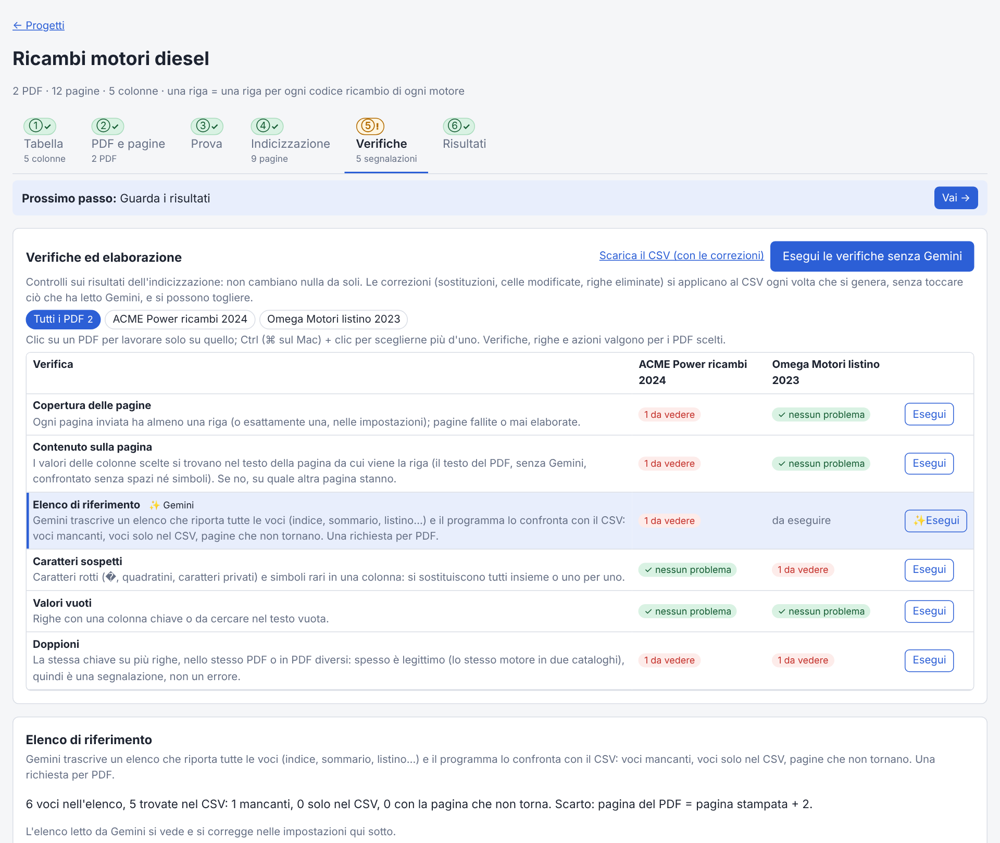
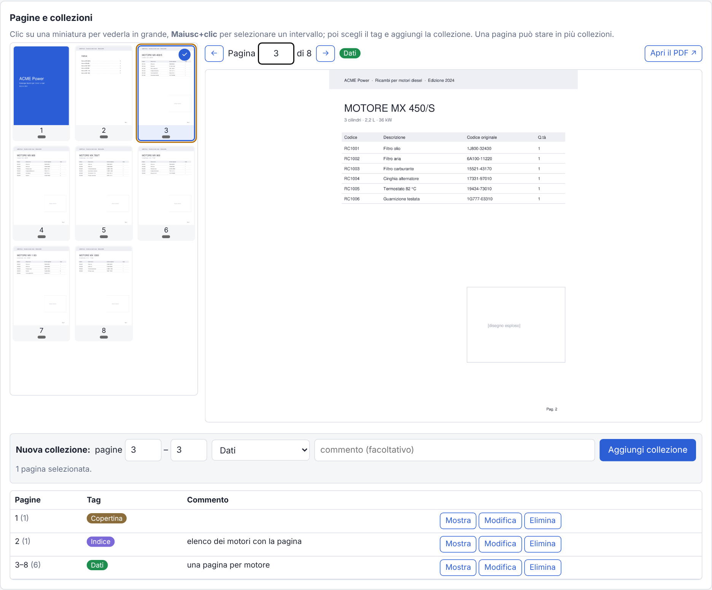
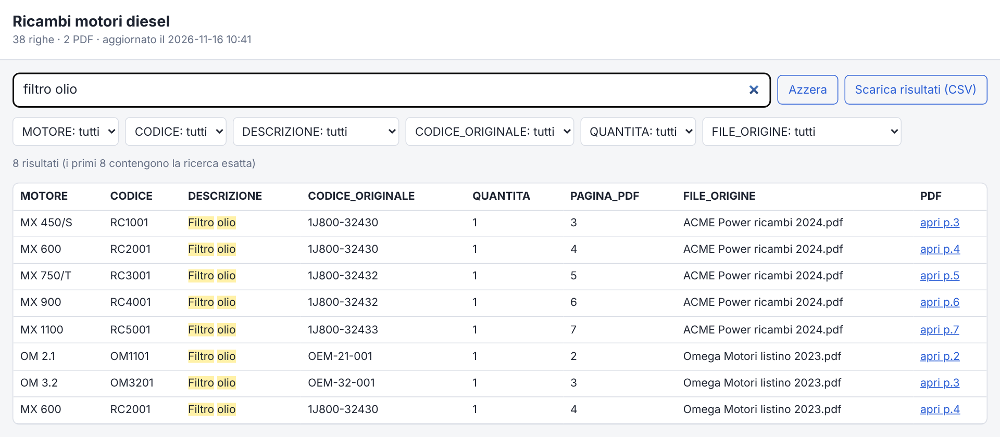

# Document Analyzer

**Turn PDF catalogs into structured, verified CSV data with Gemini vision**, plus natural-language
questions over your documents.

Built for documents where tables, drawings and layout matter as much as the text (technical
spare-parts catalogs, price lists, data sheets), where plain text extraction loses the structure.
Every page is read by Gemini as an **image plus its native text**, guided by the table you want
and by a short "how to read this catalog" guide. Then the results are **checked**, corrected and
exported as a single CSV and a standalone search page.



> Personal project. The user interface and the detailed documentation are in Italian; the
> screenshots use invented demo catalogs and the simulated Gemini client.

## Highlights

- **Library of catalogs** in folders, with tags and a **catalog card** for each PDF:
  description, data it contains, page collections (cover, index, data pages, examples).
  Gemini can propose the card and write an **indexing guide** (how to read an isolated page of
  that catalog); everything stays editable.
- **Projects**: one output table (one CSV) from one or more catalogs, with a guided path in six
  steps: ① table → ② PDFs and pages → ③ trial run on a few pages → ④ indexing →
  ⑤ verification → ⑥ results. The next step is always shown.
- **You decide the table, not the code**: what a row is, the columns, which values are page
  headers, which columns identify a row. Extraction rules are composed from the table, the
  catalog guide and per-PDF notes; nothing about a specific catalog is hard-coded.
- **Built for real API limits**: several API keys in parallel, adaptive rate limiting, retries
  on overload, quota handling, resumable jobs (pages already done are never paid twice), and an
  optional mode that sends **all the pages of a PDF in one request** (a cropped subset of the
  original PDF) to save requests on the free tier, automatically split when a response is too long.
- **Verification step**: page coverage, every value searched in the page's native text,
  comparison with the catalog's own index (missing entries, page offsets), suspicious
  characters, empty values, duplicates across PDFs. Findings can be accepted, pages can be
  re-extracted, and **corrections** (find & replace, cell edits, deleted rows) form a reversible
  layer applied on every export, without touching what Gemini read.
- **Outputs**: one CSV per project and per PDF, an anomalies report and a **standalone HTML
  search page** (tolerant search, filters, link to the exact PDF page; tested on ~30,000 rows).
- **RAG mode** (command line): Gemini describes each page using the same catalog guide, the
  descriptions go into a ChromaDB vector index, and answers cite document and page.
- **Themeable UI**: design tokens in CSS custom properties; a theme is a file that redefines the
  colors (light and dark included), chosen in the configuration.
- **Runs without an API key**: a simulated Gemini client (`DOCANALYZER_FAKE_GEMINI=1`) drives
  the whole application, and the test suite.

| Catalog card: pages and collections | Exported search page |
|---|---|
|  |  |

## How it works

```
Library ─► Catalog analysis ─► Project from a catalog ─► ① Table ② PDFs and pages ③ Trial ④ Indexing ⑤ Verification ⑥ Results

page (image + native text) ─► Gemini (page + table + catalog guide + PDF notes) ─► JSON rows for the page
                                                                                        │
             single CSV + anomalies + search page ◄─ corrections ◄─ assembly and checks ◄┘
```

- **Vision first**: tables and drawings are understood from the page image; the native text
  is sent along to transcribe codes and numbers exactly.
- **One page at a time, with context**: the catalog guide explains what a single page does not
  say (headers that are not repeated, abbreviations, where the model name is).
- **Structured output, validated**: Gemini answers with JSON against a schema built from the
  table; invalid answers are rejected and retried, never silently accepted.
- **Every result is stored per page** with a fingerprint of the rules that produced it: if the
  table, guide or notes change, only the affected PDFs are flagged for re-extraction.
- **Everything after extraction is deterministic**: assembling, checking, correcting and
  exporting never call Gemini again.

## Getting started

Requirements: **Python 3.11+** and a **Gemini API key** ([Google AI Studio](https://aistudio.google.com/apikey)).

```bash
git clone https://github.com/apgr01/document-analyzer.git
cd document-analyzer
python -m venv .venv
```

Activate the virtual environment (Windows PowerShell: `.venv\Scripts\Activate.ps1`;
macOS/Linux: `source .venv/bin/activate`), then:

```bash
pip install -e .
```

Copy `.env.example` to `.env` and add your key (`GEMINI_API_KEY_01=...`; with more keys,
`_02`, `_03`, … are used in parallel). Check the setup and start the interface:

```bash
docanalyzer doctor --online
```

```bash
docanalyzer ui
```

To try everything **without a key and without using any quota**, set
`DOCANALYZER_FAKE_GEMINI=1` before starting: Gemini's answers are simulated.

For the RAG mode: `pip install -e ".[rag]"`.

## Command line

The interface covers the whole workflow; the command line is there for automation.

| Command | What it does |
|---|---|
| `docanalyzer ui` | Web interface (local server, opens in the browser) |
| `docanalyzer doctor [--online]` | Checks keys, folders and library (and a real request to Gemini) |
| `docanalyzer add <pdf>... [--folder ...]` | Adds PDFs to the library |
| `docanalyzer list` / `remove <doc>` | Lists or removes catalogs |
| `docanalyzer project list/index/export/search <project>` | Indexes a project, regenerates the CSV without Gemini, opens the search page |
| `docanalyzer rag describe/build/ask` | Describes pages, builds the vector index, answers questions with sources |

## Tech stack and structure

Python 3.11 · FastAPI + Uvicorn (local server) · plain JavaScript and CSS (no frameworks, no
build step) · PyMuPDF (rendering, text, cropped PDFs) · Pydantic (configuration and strict
validation of model answers) · Google Gen AI SDK · ChromaDB (optional, RAG) · pytest and Ruff.

```
document-analyzer/
├── src/docanalyzer/
│   ├── core/            Gemini client (keys, rate limits, retries), PDF tools, documents, projects, config
│   ├── indexing/        rules, prompt building, extraction, assembly and checks, CSV, search page
│   ├── rag/             page descriptions, vector index, answers
│   ├── web/             FastAPI server, background jobs, themes, static UI (JS + CSS)
│   ├── verifiche.py     verification checks
│   ├── correzioni.py    corrections layer
│   └── cli.py           command line
├── configs/             default.yaml (models, rendering, rate limits, theme) and the prompts sent to Gemini
├── tests/               ~160 tests, all with the simulated Gemini client
└── docs/                user guide, architecture, glossary, roadmap (Italian)
```

Design notes and the reasons behind the main choices are in
[`docs/ARCHITETTURA.md`](docs/ARCHITETTURA.md); the step-by-step user guide is in
[`docs/GUIDA_INDICIZZAZIONE.md`](docs/GUIDA_INDICIZZAZIONE.md), the vocabulary in
[`docs/GLOSSARIO.md`](docs/GLOSSARIO.md) and the plan in [`docs/ROADMAP.md`](docs/ROADMAP.md).

## Development

```bash
pip install -e ".[dev,rag]"
pytest
ruff check .
```

The tests never call Gemini: a simulated client returns answers that follow the requested
schemas, so the whole pipeline (library, analysis, projects, extraction, verification, web API,
RAG) runs offline in a few seconds.

## License

No license is granted: all rights reserved. The code is published for portfolio purposes.
